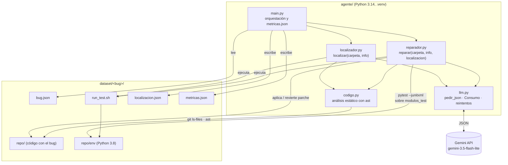
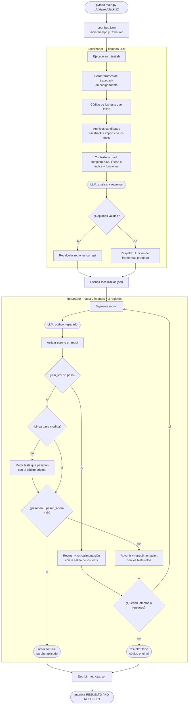
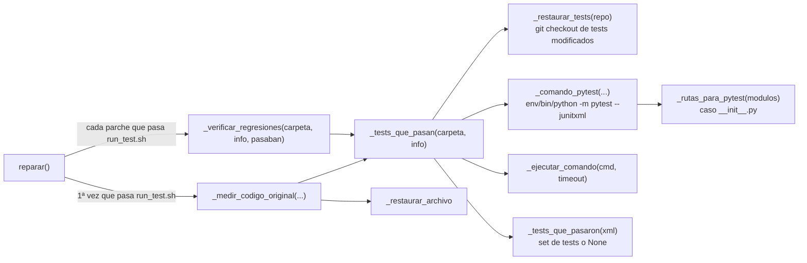
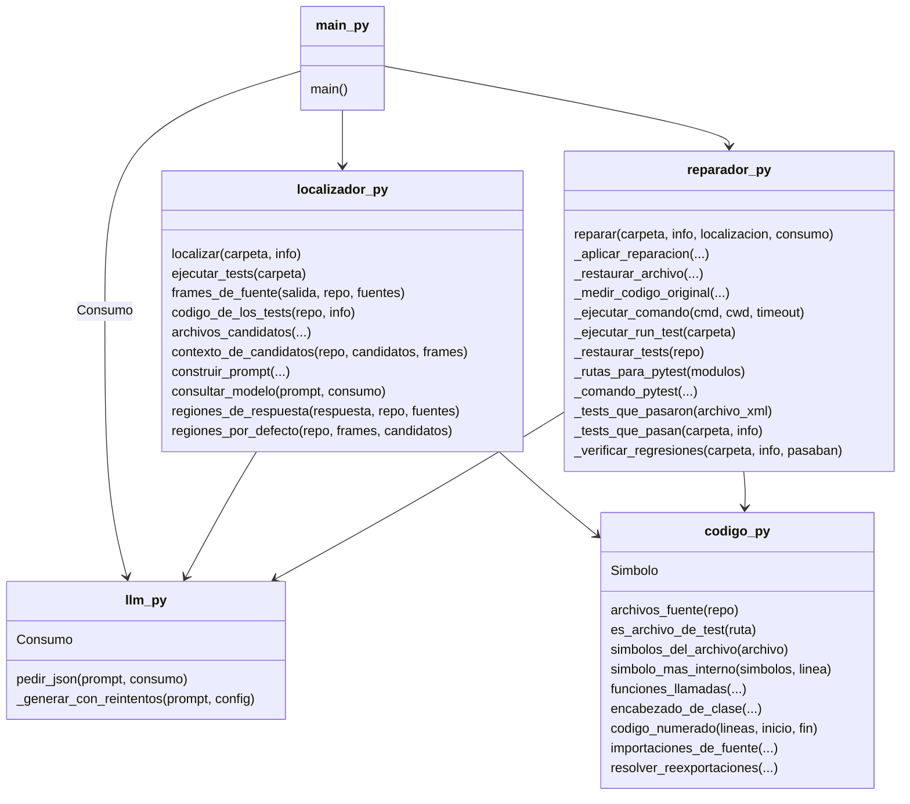

# Funcionamiento del agente — Versión 1

Este documento explica cómo funciona el agente de reparación automática (APR) en su versión 1. Tiene estas partes:

1. Las funciones nuevas de esta versión: la verificación de regresiones contra el código original.
2. El flujo completo, desde que se ejecuta `.venv/bin/python main.py ../dataset/black-12` hasta que quedan
   escritos los resultados.
3. Diagramas de la arquitectura y de la estructura del código.
4. El estado de cada componente que exige el enunciado.
5. Lo que queda pendiente.

---

## 1. Funciones nuevas implementadas

### El problema que resuelven

La versión anterior de `_verificar_regresiones` corría cada módulo de `modulos_test` y exigía que el módulo
**completo** terminara con código 0. Eso tenía dos fallas:

- **Rechazaba arreglos correctos.** Si un módulo tenía un test que ya fallaba con el código original (por ejemplo,
  uno que necesita red o una dependencia del sistema), cualquier parche se consideraba "con regresiones" y se
  revertía.
- **No coincidía con la definición del enunciado.** Una regresión es un test que *pasaba* con el código original
  y deja de pasar con el cambio. No es "cualquier test que falle".

Además, llamaba a `env/bin/pytest` directamente. Ese script depende de su shebang, que se rompe si la carpeta del
proyecto se mueve.

### La solución

La regresión se calcula como una **resta de conjuntos**:

```
regresiones = (tests que pasaban con el código original) − (tests que pasan con el parche)
```

Así, los tests que ya fallaban antes, incluido el test objetivo, nunca cuentan como regresión.

Todas las funciones nuevas están en `agente/reparador.py`.

### Constantes nuevas

| Constante | Valor | Para qué |
|---|---|---|
| `SEGUNDOS_MAX_REGRESION` | `90` | Tiempo máximo para correr los `modulos_test` completos una vez. |
| `MAX_REGRESIONES_EN_RETROALIMENTACION` | `15` | Cuántos tests rotos se nombran como máximo en el prompt de reintento, para no inflarlo. |

### `_restaurar_tests(repo)`

Deja los archivos de test como en el commit original, igual que hace `run_test.sh` antes de correr.

1. Lista con `git diff --name-only` los archivos modificados del repo.
2. Se queda con los que son de test, usando `es_archivo_de_test` (la misma regex `ES_TEST` que usan
   `run_test.sh` y `verificar.py`).
3. Los devuelve al original con `git checkout -- <archivos>`.

**Por qué:** algunos tests reescriben sus propios datos al ejecutarse. Si no se restauran, la medición podría dar
fallos que no tienen nada que ver con el parche.

### `_rutas_para_pytest(modulos)`

Convierte la lista `modulos_test` de `bug.json` en las rutas y opciones que recibe pytest.

- Caso normal: la ruta se pasa tal cual (`tests/test_black.py`).
- Caso especial: pytest no recolecta tests definidos en un `__init__.py`. En ese caso se pasa la carpeta y se
  agrega la opción `-o python_files=__init__.py test_*.py *_test.py`. Es el mismo criterio que usa
  `herramientas/verificar.py`.

Devuelve `(rutas, opciones)`.

### `_comando_pytest(repo, modulos, archivo_xml, carpeta_cache)`

Arma el comando que corre los módulos de test, como una lista con un argumento por línea:

```
env XDG_CACHE_HOME=<carpeta temporal>  repo/env/bin/python -m pytest
    -p no:cacheprovider -q --continue-on-collection-errors --junitxml=<archivo_xml>
    <opciones> <rutas>
```

- **`repo/env/bin/python -m pytest`:** usa el Python 3.8 del bug y no depende del shebang de `env/bin/pytest`.
- **`XDG_CACHE_HOME` en una carpeta temporal:** caché de usuario limpia, igual que `run_test.sh`. Algunos proyectos
  cachean artefactos generados por su propio código.
- **`--junitxml`:** pytest escribe un XML con el resultado de **cada** test, lo que permite comparar test por test.
- **`--continue-on-collection-errors`:** si un archivo no se puede importar, se miden igual los demás.
- **pytest aunque el bug use unittest:** pytest también ejecuta tests escritos con unittest, y es lo que usan
  `verificar.py` y el evaluador. Así se mide la regresión con el mismo criterio con el que se evalúa.

### `_tests_que_pasaron(archivo_xml)`

Lee el XML de pytest y devuelve el conjunto de tests que pasaron, con nombres del tipo
`tests.test_black.BlackTestCase::test_black`.

- Un test pasó si su nodo `<testcase>` no tiene hijos `failure`, `error` ni `skipped`.
- Si el XML no existe o está roto, devuelve **`None`** y no un conjunto vacío. Eso pasa, por ejemplo, cuando pytest
  se cortó por timeout. `None` significa "no se pudo medir", que es distinto de "no pasó ningún test".

### `_tests_que_pasan(carpeta, info)`

La función principal de la medición. Se lee en tres pasos:

1. Restaurar los tests (`_restaurar_tests`).
2. Correr pytest sobre `modulos_test` en una carpeta temporal (`_comando_pytest` + `_ejecutar_comando` con
   timeout `SEGUNDOS_MAX_REGRESION`).
3. Leer qué tests pasaron (`_tests_que_pasaron`).

Devuelve `set[str]` o `None`.

### `_medir_codigo_original(carpeta, info, archivo_path, lineas_originales)`

Mide qué tests pasaban **con el código original**, aunque en ese momento el parche esté aplicado.

1. Guarda el contenido del archivo con el parche y deja el original.
2. Mide con `_tests_que_pasan`.
3. Vuelve a poner el parche. Esto ocurre en un `finally`, así que el parche vuelve aunque la medición falle.

**Por qué basta con un archivo:** cuando se llama, el único archivo modificado del repo es el del parche actual.
Los intentos anteriores ya fueron revertidos.

### `_verificar_regresiones(carpeta, info, pasaban)` (reescrita)

Compara los tests que pasan con el parche contra `pasaban`, los que pasaban con el código original. Devuelve
`(sin_regresiones, mensaje)`.

1. **Si no hay con qué comparar, no rechaza.** Puede que no haya `modulos_test`, que `pasaban` sea `None`, o que la
   medición con el parche devuelva `None`. En esos casos devuelve `True` con un mensaje que dice "regresión no
   verificada". El parche ya hizo pasar los tests objetivo, y revertirlo significaría perder seguro un bug que
   probablemente está arreglado.
2. Mide con el parche aplicado (`_tests_que_pasan`).
3. Calcula `regresiones = pasaban − pasan_ahora`.
4. Si hay regresiones, arma un mensaje con hasta 15 nombres de tests rotos. Ese mensaje se usa como
   retroalimentación para el siguiente intento del modelo.

### Cambios dentro de `reparar()`

- **Dos variables nuevas antes del bucle de regiones**, `pasaban = None` y `linea_base_medida = False`.
- **Medición perezosa del código original.** Solo se hace la primera vez que un parche hace pasar los tests
  objetivo. Si ningún intento llega a esa etapa, no se gasta tiempo corriendo `modulos_test`. Se mide **una sola
  vez por bug**: `linea_base_medida` queda en `True` aunque la medición haya devuelto `None`, para no repetir una
  medición que ya se pasó de tiempo.
- **Retroalimentación con los nombres de los tests rotos**, en vez de la salida cruda de pytest recortada.
- **Campo extra `verificacion_regresion` en el resultado.** Dice si la regresión se comprobó de verdad
  (`"Sin regresiones."`) o no se pudo verificar.

### Cómo se probó

En black-12, con Gemini y `run_test.sh` simulados para no gastar cuota:

- **Un parche que hace que `format_str` devuelva el texto sin formatear.** Se detectó la regresión. El modelo
  recibió en el segundo intento la lista de tests rotos (`test_black`, `test_cantfit`, …), el archivo se revirtió
  y `repo/` quedó limpio.
- **Un parche que no cambia nada.** El test objetivo, que ya fallaba con el código original, no se contó como
  regresión: el resultado fue `"Sin regresiones."`.
- **Medición de la línea base en los 12 bugs.** Funcionó en todos. Por ejemplo, en black-12 pasan 73 tests en
  ~4 s y en scrapy-37 pasan 164.

---

## 2. Flujo de reparación

Lo que pasa al ejecutar, desde `agente/`:

```bash
set -a; source config.env; set +a        # exporta GEMINI_API_KEY (desarrollo local)
.venv/bin/python main.py ../dataset/black-12
```

### Paso 0 — `main.py`: preparación

1. Lee `../dataset/black-12/bug.json`, con `id`, `comandos_test`, `archivos_test` y `modulos_test`.
2. Empieza a medir el tiempo (`time.perf_counter()`).
3. Crea un `Consumo` global, que acumula llamadas y tokens de **ambas** etapas.

### Paso 1 — Localizador (`localizador.localizar`)

Decide **dónde** está el bug. Hace **1 llamada** al LLM.

1. **Ejecuta los tests del bug** (`ejecutar_tests`). Corre `run_test.sh` con un timeout de 60 s y guarda los
   últimos 8000 caracteres de la salida, que es donde están el traceback y la aserción.
2. **Extrae los frames del traceback** (`frames_de_fuente`) con dos regex: estilo Python
   (`File "x.py", line 12`) y estilo pytest (`x.py:12: in f`). Solo conserva los frames que caen en código
   fuente del repo, nunca en tests ni librerías. Quedan ordenados del más profundo al menos profundo.
3. **Obtiene el código de los tests que fallan** (`codigo_de_los_tests`). Saca el nombre de cada test desde
   `comandos_test` y extrae su función, numerada, de los `archivos_test`.
4. **Elige los archivos candidatos** (`archivos_candidatos`, máximo 6):
   - primero, los archivos del traceback;
   - después, los módulos que importan los tests, resolviendo las reexportaciones de los `__init__.py`. Se
     ordenan según cuánto usa sus nombres el test que falla.
5. **Arma el contexto** (`contexto_de_candidatos`, máximo 80 000 caracteres):
   - si el archivo tiene 400 líneas o menos, va completo y numerado;
   - si es más largo, va un índice de sus funciones con sus líneas, más el código de las funciones del
     traceback. Las dos más profundas van además con los atributos de su clase y las funciones que llaman.
6. **Consulta al modelo** (`consultar_modelo` → `llm.pedir_json`). El prompt incluye los comandos de test, la
   salida, el código de los tests y el contexto. El modelo responde un JSON con `analisis` y hasta 3
   `regiones` (`archivo`, `simbolo`, `inicio`, `fin`).
7. **Valida las regiones** (`regiones_de_respuesta` → `region_propuesta`):
   - se descartan los archivos que no son fuente;
   - si el modelo nombra un símbolo, la región se recalcula con `ast` y pasa a ser la función completa;
   - si no lo nombra pero `inicio` cae dentro de una función, se usa esa función;
   - si no, se aceptan `inicio`/`fin` tal cual, si son líneas válidas.
8. **Respaldo** (`regiones_por_defecto`): si el modelo falla o no da regiones válidas, se usa la función del
   frame más profundo del traceback o, si no hay frames, el primer candidato.

Devuelve `{"regiones", "analisis", "salida_tests", "coste"}`.

### Paso 1b — `main.py`: guarda la localización

- Suma el `coste` del localizador al `Consumo` global.
- Escribe `localizacion.json` en la carpeta del bug, solo con `{"regiones": [...]}`.

### Paso 2 — Reparador (`reparador.reparar`)

Genera, aplica y verifica el cambio. Hace hasta **2 llamadas por región**, con un máximo de 3 regiones, o sea
**6 llamadas** en el peor caso.

Para cada región, de la más a la menos sospechosa:

1. Lee el archivo y valida que las líneas existan.
2. **Hasta 2 intentos.** En cada uno:
   1. **Pide el arreglo al LLM.** El prompt incluye el archivo, el rango de líneas, el análisis del
      localizador, la salida original de los tests, la retroalimentación del intento anterior si la hay, y el
      código numerado de la región. El modelo responde `{"analisis_arreglo", "codigo_reparado"}`.
   2. **Aplica el parche** (`_aplicar_reparacion`): reemplaza exactamente las líneas `inicio..fin` por
      `codigo_reparado`.
   3. **Verifica los tests objetivo** (`_ejecutar_run_test`, timeout 40 s). Si siguen fallando, revierte el
      archivo, guarda los últimos 3000 caracteres de la salida como retroalimentación y pasa al siguiente
      intento.
   4. **Mide la línea base, solo la primera vez** (`_medir_codigo_original`): los tests de `modulos_test` que
      pasaban con el código original.
   5. **Verifica regresiones** (`_verificar_regresiones`). Si hay, revierte el archivo, usa los nombres de los
      tests rotos como retroalimentación y pasa al siguiente intento.
   6. **Si todo pasa:** devuelve `{"resuelto": True, "region_aplicada", "verificacion_regresion", "coste"}` y
      el parche queda aplicado en `repo/`.
3. Si se agotan las regiones, devuelve `{"resuelto": False}` y `repo/` queda con el código original.

Si una llamada al LLM falla (error de API o JSON inválido), se informa por `stderr` y se pasa al siguiente
intento sin caerse.

### Paso 3 — `main.py`: métricas

Escribe `metricas.json` con exactamente:

```json
{"bug": "black-12", "modelo": "gemini-3.5-flash-lite", "llamadas": 2,
 "tokens_entrada": 15857, "tokens_salida": 788, "segundos": 14.6}
```

- `llamadas`, `tokens_entrada`, `tokens_salida`: el `Consumo` global de ambas etapas. `llm.Consumo.registrar`
  solo cuenta las llamadas que obtuvieron respuesta, y suma `prompt_token_count` y `candidates_token_count`.
- `segundos`: desde el inicio de `main()`, incluyendo la ejecución de tests.

Al final imprime `black-12: RESUELTO` o `NO RESUELTO`.

### Soporte transversal: `llm.pedir_json`

- Llama a `gemini-3.5-flash-lite` con `response_mime_type="application/json"` y `temperature=0`.
- Ante errores temporales (429, 500, 503, 504) reintenta hasta 5 veces, con esperas de 2, 4, 8 y 16 s.
- Limpia la respuesta: quita bloques ```` ```json ````, escapa backslashes inválidos y elimina caracteres de
  control antes de decodificar el JSON.

---

## 3. Arquitectura y estructura del código

### 3.1 Módulos y dependencias



### 3.2 Flujo del pipeline



### 3.3 Verificación de regresiones (funciones nuevas)



### 3.4 Funciones por archivo



---

## 4. Componentes esperados del agente

Tabla de la sección 2.2 del enunciado (página 3), con el estado de cada pieza en esta versión:

- 🟢 implementado
- 🟡 implementado parcialmente
- 🔴 no implementado aún

| Pieza | Problema que resuelve | Mínimo | Logro |
|---|---|---|---|
| 1. Orquestación (`main.py`) | Coordinar las etapas y asegurar que siempre queden escritos los resultados. | Ejecuta localizador→reparador y escribe ambos JSON con el formato exigido. | 🟡 Ejecuta ambas etapas y escribe los dos JSON, pero sin `try/finally`: si una etapa lanza una excepción, no quedan escritos. Tampoco hay control global del límite de 3 minutos. |
| 2. Ejecución e interpretación de tests | Saber qué falla y obtener información útil de esa falla. | Ejecuta los tests del bug y distingue si pasan o fallan. | 🟢 `ejecutar_tests` / `_ejecutar_run_test` corren `run_test.sh` con timeout, usan el código de salida y guardan el final de la salida (traceback y aserción). |
| 3. Señales para localizar | Decidir dónde mirar sin revisar todo el repositorio. | Usa al menos una señal obtenida de los tests (su salida o su código) para acotar dónde buscar. | 🟢 Frames del traceback en código fuente, código de los tests que fallan y módulos que importan (resolviendo reexportaciones). |
| 4. Construcción del contexto | Decidir qué información recibe el LLM y cuánta. | Envía al LLM el código de la región sospechosa y la información de la falla. | 🟢 Contexto acotado (archivo completo si ≤400 líneas; si no, índice + funciones del traceback), y al reparador la región numerada, el análisis y la salida de los tests. |
| 5. Formato de respuesta y aplicación del cambio | Convertir la respuesta del LLM en un cambio real sobre el código. | Pide una respuesta procesable y la aplica al código fuente (nunca a los tests). | 🟢 Respuesta JSON (`codigo_reparado`) que reemplaza las líneas de la región; las regiones que no son fuente se descartan. Falta validar el tipo y hacer `ast.parse` antes de correr tests (pendiente 5). |
| 6. Verificación | Saber si la reparación realmente funciona. | Tras aplicar el cambio, ejecuta los tests del bug. | 🟢 Corre `run_test.sh` tras cada parche y además verifica regresiones contra el código original. |
| 7. Reintentos con retroalimentación | Qué hacer cuando la reparación no funciona. | Reintenta cuando la reparación falla. | 🟢 Hasta 2 intentos por región y 3 regiones, con la salida de los tests o los tests rotos como retroalimentación. Falta incluir el código propuesto (pendiente 6). |
| 8. Robustez ante la API | Seguir funcionando cuando la API falla o responde algo inválido. | No se cae ante un error de la API. | 🟡 Reintentos con backoff ante 429/500/503/504 y captura de `APIError` y JSON inválido en ambas etapas, pero los errores de red de `httpx` no se capturan y pueden botar el agente. |
| 9. Medición del costo | Saber cuánto cuesta reparar cada bug. | Cuenta llamadas, tokens y tiempo en `metricas.json` según la Sección 2.3. | 🟢 `Consumo` suma llamadas con respuesta y tokens de ambas etapas; `segundos` incluye los tests. Depende de la pieza 1 para escribirse siempre. |
| 10. Generalización | Funcionar con bugs y proyectos no vistos. | No hay nada específico de un bug o proyecto en el código. | 🟢 Las heurísticas son genéricas (traceback, imports, `ast`, `modulos_test` de `bug.json`); el runner se infiere de `comandos_test`. |

---

## 5. Pendiente para las siguientes versiones

De la revisión contra el enunciado quedan estos puntos:

| # | Punto | Dónde |
|---|---|---|
| 2 | **Control de tiempo global** (≤ 3 min por bug): plazo en `main.py`, timeouts de los subprocesos y backoff ajustados al tiempo restante. | `main.py`, `reparador.py`, `localizador.py`, `llm.py` |
| 3 | **Escribir siempre los JSON**: `try/except` por etapa y `finally` en `main.py`; reintentar errores de red de `httpx`. | `main.py`, `llm.py` |
| 5 | **Validar la respuesta antes de correr tests**: comprobar que `codigo_reparado` sea `str` y hacer `ast.parse` del archivo parcheado. | `reparador.py` |
| 6 | **Incluir el código propuesto en la retroalimentación** del reintento. | `reparador.py` |
| 7 | **Limpieza**: esqueletos comentados y docstrings duplicados. | `main.py`, `reparador.py` |
| 8 | *(opcional)* Darle más contexto al reparador y usar ediciones buscar/reemplazar en varias regiones. | `reparador.py` |
